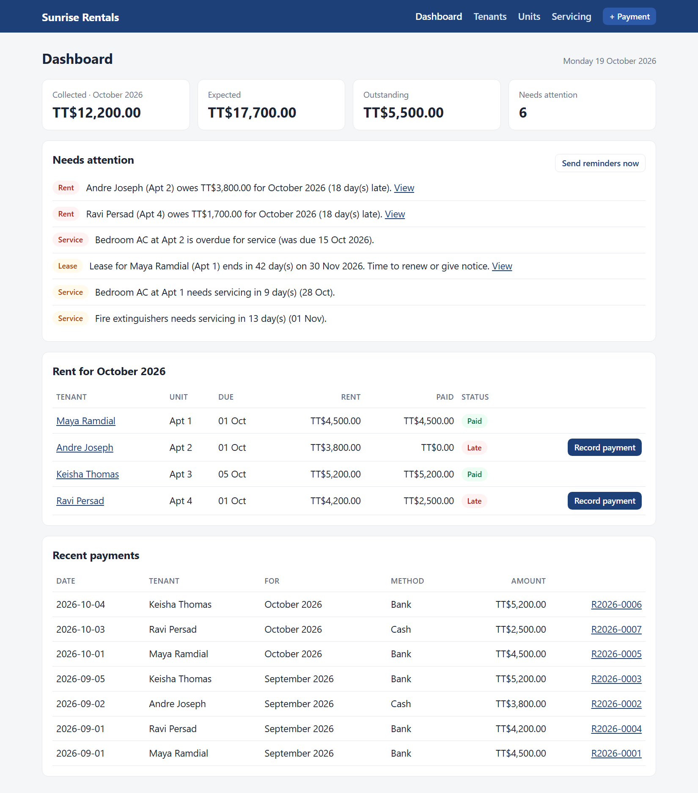
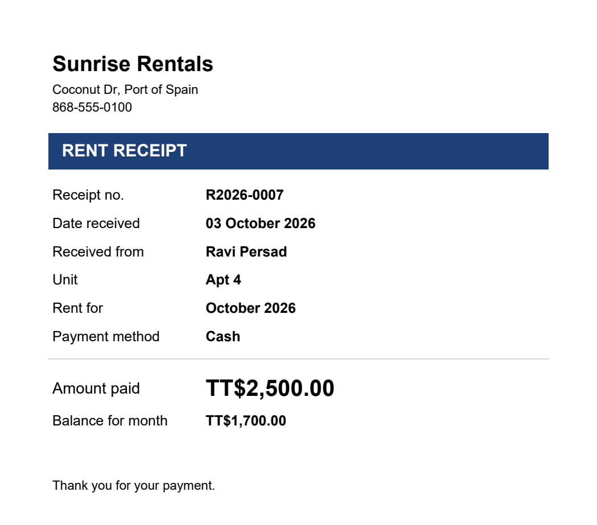
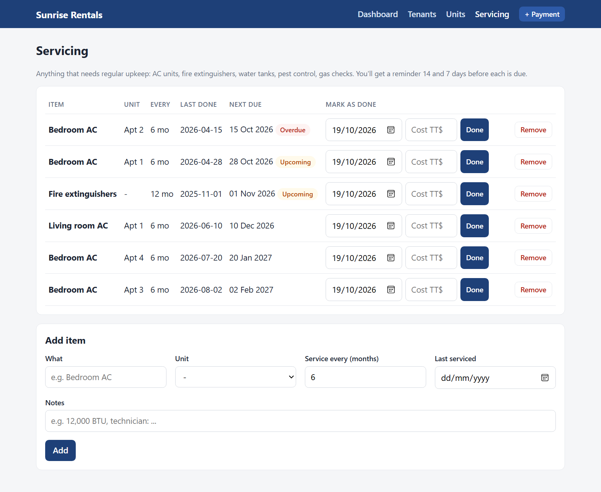

# Property Manager

A small web app that automates the routine work of managing rental units: receipts, rent reminders, lease renewals and maintenance schedules. Built for a 4-unit rental property in Trinidad and Tobago.

**Built with:** Python, Flask, SQLite, APScheduler (daily reminders), fpdf2 (PDF receipts), SMTP email and the WhatsApp Cloud API.

## Features

- **Receipts**: record a cash or bank payment and the tenant gets a PDF receipt by email and/or WhatsApp.
- **Lease alerts**: you're told 90, 60, 30 and 7 days before a lease ends.
- **Rent reminders**: tenants get a friendly reminder 3 days before rent is due; you and they are alerted at 1, 3, 7 and 14 days late. Partial payments are tracked.
- **Servicing**: AC units (or anything else, like fire extinguishers or water tanks) with a service schedule. You're reminded 14 and 7 days before each is due.
- **Dashboard**: this month's collections, who's paid, what needs attention.

Each reminder is sent only once per stage. Reminders go out every morning at 8am Trinidad time while the app is running.

| Automatic PDF receipt | Maintenance schedule |
|---|---|
|  |  |

*Screenshots use made-up demo data.*

## Start it

Double-click **start.bat**. It installs what's needed, creates your `.env` settings file and opens http://localhost:5000.

Then:
1. **Units**: add your 4 units.
2. **Tenants**: add each tenant with their rent, due day, lease dates, WhatsApp and email.
3. **Servicing**: add each AC unit with the date it was last serviced.
4. Open `.env` in Notepad and fill in your business name and contact details. Restart the app after any change.

Rent is tracked from the month you add a tenant. To record older payments, use **+ Payment** and pick the month.

## Setting up email (about 5 minutes)

Using Gmail:
1. Turn on 2-Step Verification for your Google account.
2. Go to https://myaccount.google.com/apppasswords and create an app password.
3. In `.env`, set `SMTP_USER` to your Gmail address and `SMTP_PASSWORD` to the 16-character app password. Set `OWNER_EMAIL` to where you want your alerts.

## Setting up WhatsApp (a few days, because Meta reviews it)

WhatsApp only lets businesses send messages that start a conversation using **pre-approved templates**.

1. Create a Meta Business account at https://business.facebook.com and verify your business.
2. At https://developers.facebook.com create an app, then add the **WhatsApp** product.
3. Add a phone number for the business. It must be a number that isn't already using the normal WhatsApp app.
4. Copy the **Phone number ID** into `WA_PHONE_NUMBER_ID`. Create a **permanent access token** (through a System User in Business Settings) and put it in `WA_TOKEN`.
5. In WhatsApp Manager, under Message templates, create these three templates (category **Utility**, language **English**):

| Name | Header | Body |
|---|---|---|
| `payment_receipt` | Document | `Hi {{1}}, thank you for your payment of {{2}}. Your receipt {{3}} is attached.` |
| `rent_reminder` | none | `Hi {{1}}, a friendly reminder that rent of {{2}} is due on {{3}}. If you have already paid, please ignore this message.` |
| `owner_alert` | none | `Property alerts: {{1}}` |

6. Set `OWNER_WHATSAPP` to your own number to get your alerts on WhatsApp.

You can change the wording, but keep the same number of `{{ }}` blanks in the same order.

## Keeping it running

Reminders only go out while the app is running. Each time it starts it catches up on anything missed, so leaving it on a home PC works. For it to run all the time and be reachable from your phone, put it on a small cloud server (e.g. Railway, Render or a VPS). **Set `APP_PASSWORD` before you do.**

Your data is in `data/property.db` and receipts are in `data/receipts/`. Back up the `data` folder regularly.

## Planned next

- WhatsApp assistant: tenants report maintenance problems (with photos) and ask for their balance; the AI logs a ticket and alerts you.
- Tenants send a bank transfer screenshot; the AI reads it and you approve with one tap.
- Expenses per unit, and a monthly income report.
